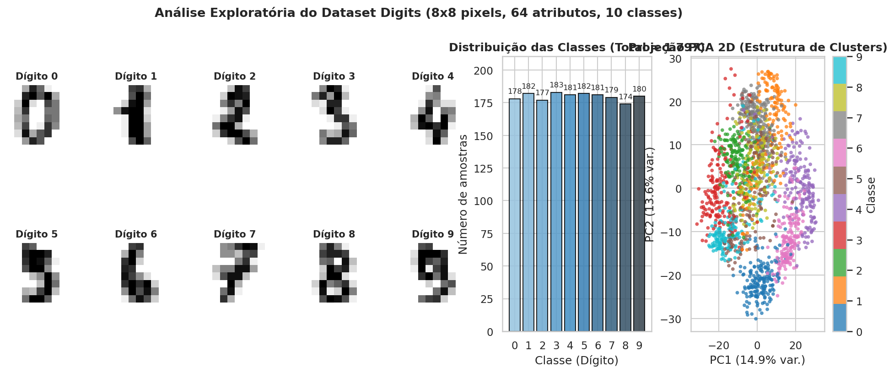
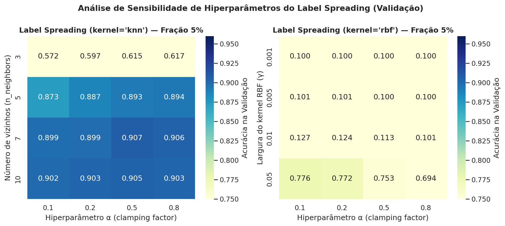
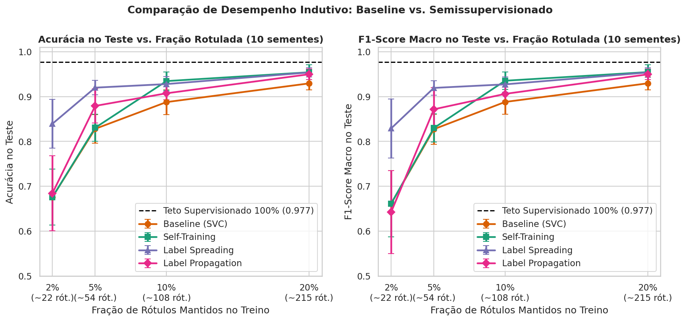
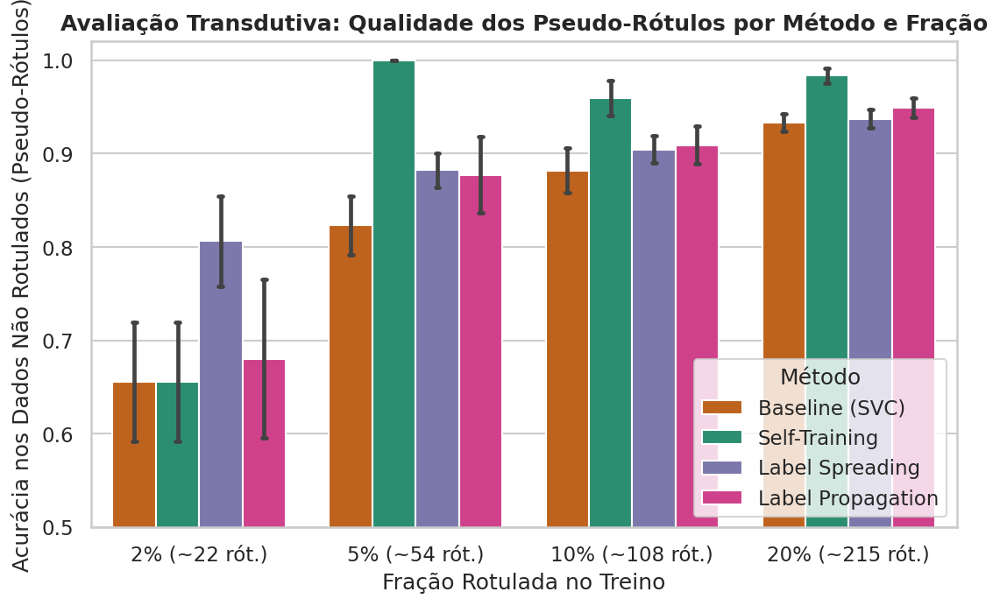
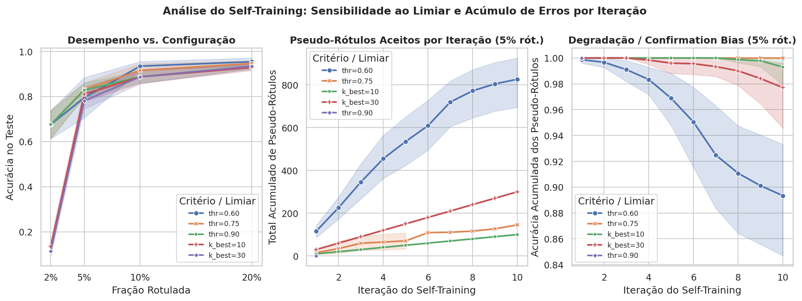
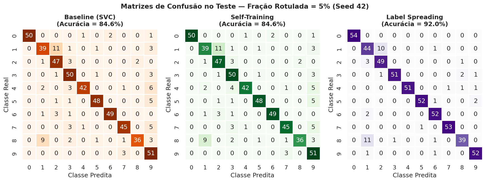
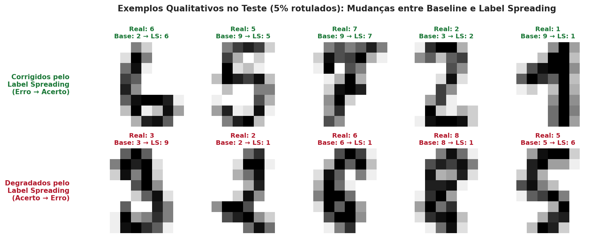
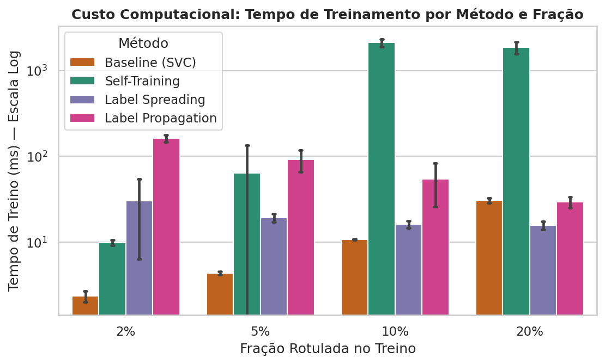

# Relatório Técnico: Aprendizado Semissupervisionado no Dataset Digits

**Comparação:** Baseline Supervisionado (`SVC`) × `SelfTrainingClassifier` × `LabelSpreading` (e `LabelPropagation`)  
**Dataset:** `sklearn.datasets.load_digits` (1.797 amostras, 64 atributos, 10 classes)

---

## 1. Introdução

Em problemas reais de aprendizado de máquina, a obtenção de grandes volumes de exemplos não rotulados costuma ser rápida e de baixo custo, enquanto a rotulagem manual exige tempo de especialistas humanos. O **Aprendizado Semissupervisionado (SSL)** propõe combinar um pequeno conjunto de dados rotulados $X_L$ com um conjunto muito maior de dados não rotulados $X_U$ durante o treinamento para melhorar a generalização do classificador.

O objetivo deste estudo experimental é avaliar sistematicamente em que medida os dados não rotulados auxiliam na classificação de dígitos manuscritos (`load_digits`) quando apenas **2%, 5%, 10% ou 20%** dos rótulos de treinamento estão disponíveis, testando quatro hipóteses principais:
- **H1:** Com poucos rótulos disponíveis, *Self-Training* e *Label Spreading* superam o *Baseline* supervisionado.
- **H2:** À medida que a fração rotulada cresce, a vantagem dos métodos semissupervisionados diminui e os modelos convergem em direção ao teto supervisionado (100% dos rótulos).
- **H3:** O *Label Spreading* apresenta forte desempenho no *Digits* porque as classes formam agrupamentos (*clusters*) e variedades bem definidas no espaço de atributos.
- **H4:** O *Self-Training* é sensível ao limiar de confiança (`threshold`) e ao critério `k_best`, estando sujeito ao viés de confirmação (*confirmation bias*).

---

## 2. Fundamentação Teórica

Os algoritmos semissupervisionados apoiam-se nas suposições de **suavidade** (pontos próximos em regiões densas compartilham o mesmo rótulo), **cluster** (fronteiras de decisão devem atravessar regiões de baixa densidade) e **variedade (*manifold*)** (os dados distribuem-se ao longo de subvariedades de menor dimensão).

- **Self-Training (Yarowsky, 1995):** Método *wrapper* iterativo que treina um classificador probabilístico base (`SVC(kernel="rbf", probability=True)`) nos dados rotulados atuais, atribui pseudo-rótulos às amostras não rotuladas cuja probabilidade predita supera um limiar $\tau$ (ou às `k_best` amostras mais confiantes) e re-treina o classificador até convergir ou atingir `max_iter=10`.
- **Label Spreading (Zhou et al., 2004):** Método baseado em grafos que constrói uma matriz de afinidade $W$ (via grafo *k-NN* ou kernel RBF) e propaga rótulos usando o Laplaciano simétrico normalizado $S = D^{-1/2}WD^{-1/2}$ segundo a regra iterativa $F^{(t+1)} = \alpha S F^{(t)} + (1-\alpha)Y^{(0)}$, onde $\alpha \in (0, 1)$ (*clamping factor*) controla a suavização relativa aos rótulos iniciais. Diferentemente do **Label Propagation** (Zhu & Ghahramani, 2002), que fixa rigidamente os rótulos iniciais (*hard clamping*), o *Label Spreading* permite suavização regularizada.

---

## 3. Metodologia e Protocolo Experimental

1. **Divisão Estratificada dos Dados (1.797 amostras):**
   - **Treino (60% = 1.078 amostras):** subdividido entre amostras que mantêm seu rótulo verdadeiro e amostras mascaradas com `-1`.
   - **Validação (10% = 180 amostras):** usado exclusivamente para seleção de hiperparâmetros.
   - **Teste (30% = 540 amostras):** conjunto isolado para avaliação indutiva final.
2. **Prevenção de Vazamento de Dados (*Data Leakage*):** O `StandardScaler` é ajustado (`fit`) apenas nas 1.078 amostras de treino de cada semente e aplicado a treino, validação e teste.
3. **Mascaramento Estratificado:** Frações avaliadas de **2%, 5%, 10% e 20%** do conjunto de treino (correspondendo a **22, 54, 108 e 215 amostras rotuladas**, garantindo no mínimo 2 amostras por classe mesmo em 2%).
4. **Repetições Estatísticas:** **10 sementes aleatórias** (`42` a `51`) controlando tanto a partição dos conjuntos quanto o mascaramento dos rótulos.

---

## 4. Resultados Experimentais

### 4.1 Escolha de Hiperparâmetros na Validação

A busca em grade no conjunto de validação identificou as seguintes configurações ótimas por fração:

| Fração Rotulada | Melhor Self-Training (Validação) | Acurácia Val (ST) | Melhor Label Spreading (Validação) | Acurácia Val (LS) |
| :---: | :---: | :---: | :---: | :---: |
| **2% (~22 rót.)** | `threshold=0.60` | 65,44% | `kernel="knn", n_neighbors=10, alpha=0.8` | **83,06%** |
| **5% (~54 rót.)** | `threshold=0.75` | 82,28% | `kernel="knn", n_neighbors=7, alpha=0.5` | **90,72%** |
| **10% (~108 rót.)** | `threshold=0.60` | **92,83%** | `kernel="knn", n_neighbors=7, alpha=0.2` | 92,67% |
| **20% (~215 rót.)** | `threshold=0.60` | **95,11%** | `kernel="knn", n_neighbors=7, alpha=0.2` | 94,83% |

### 4.2 Desempenho Indutivo no Conjunto de Teste e Transdutivo nos Pseudo-Rótulos

A tabela a seguir apresenta a **média ± desvio padrão** nas 10 sementes para todos os métodos avaliados:

| Fração | Método | Configuração Selecionada | Acurácia Teste (%) | F1 Macro Teste (%) | Acurácia Pseudo-Rótulos (%) | Tempo de Treino (ms) |
| :---: | :--- | :--- | :---: | :---: | :---: | :---: |
| **2%** | Baseline (SVC) | `kernel=rbf, C=1.0` | 67,59 ± 6,27 | 66,13 ± 7,36 | 65,58 ± 6,40 | 2,1 ± 0,1 |
| **2%** | Self-Training | `thr=0.60` | 67,59 ± 6,27 | 66,13 ± 7,36 | 65,58 ± 6,40 | 9,4 ± 1,0 |
| **2%** | **Label Spreading** | `knn (k=10), α=0.8` | **83,94 ± 5,40** | **82,90 ± 6,57** | **80,61 ± 4,80** | 20,3 ± 2,3 |
| **2%** | Label Propagation | `knn (k=10)` | 68,44 ± 8,33 | 64,23 ± 9,27 | 68,01 ± 8,48 | 144,7 ± 10,5 |
| **5%** | Baseline (SVC) | `kernel=rbf, C=1.0` | 82,81 ± 3,16 | 82,74 ± 3,35 | 82,31 ± 3,17 | 4,3 ± 0,2 |
| **5%** | Self-Training | `thr=0.75` | 83,06 ± 2,98 | 83,00 ± 3,16 | **100,00 ± 0,00** *(26,6 aceitos)* | 63,1 ± 71,2 |
| **5%** | **Label Spreading** | `knn (k=7), α=0.5` | **92,00 ± 1,59** | **91,94 ± 1,63** | 88,22 ± 1,81 | 17,9 ± 2,8 |
| **5%** | Label Propagation | `knn (k=7)` | 87,93 ± 3,82 | 87,17 ± 4,81 | 87,73 ± 4,08 | 92,3 ± 32,4 |
| **10%** | Baseline (SVC) | `kernel=rbf, C=1.0` | 88,78 ± 2,75 | 88,81 ± 2,74 | 88,18 ± 2,37 | 11,0 ± 0,9 |
| **10%** | **Self-Training** | `thr=0.60` | **93,46 ± 2,04** | **93,54 ± 1,99** | **95,97 ± 1,86** | 2105,8 ± 256,7 |
| **10%** | Label Spreading | `knn (k=7), α=0.2` | 92,80 ± 1,66 | 92,73 ± 1,70 | 90,44 ± 1,43 | 17,6 ± 1,8 |
| **10%** | Label Propagation | `knn (k=7)` | 90,74 ± 1,46 | 90,61 ± 1,55 | 90,92 ± 2,02 | 57,5 ± 27,4 |
| **20%** | Baseline (SVC) | `kernel=rbf, C=1.0` | 92,94 ± 1,46 | 92,96 ± 1,47 | 93,33 ± 0,91 | 30,8 ± 1,9 |
| **20%** | **Self-Training** | `thr=0.60` | **95,43 ± 1,67** | **95,46 ± 1,63** | **98,35 ± 0,82** | 1867,8 ± 316,2 |
| **20%** | Label Spreading | `knn (k=7), α=0.2` | 95,39 ± 1,03 | 95,38 ± 1,03 | 93,73 ± 0,99 | 16,7 ± 1,8 |
| **20%** | Label Propagation | `knn (k=7)` | 94,98 ± 1,16 | 94,96 ± 1,18 | 94,92 ± 1,01 | 28,9 ± 5,7 |
| **100%** | **Supervisionado (Teto)** | `100% rótulos (1.078)` | **97,74 ± 0,63** | **97,74 ± 0,63** | 100,00 ± 0,00 | 271,2 ± 13,3 |

### 4.3 Teste Estatístico Pareado de Wilcoxon

| Fração | Comparação Pareada | Δ Acurácia Médio (p.p.) | p-valor (Acurácia) | Significativo ($p < 0.05$)? |
| :---: | :--- | :---: | :---: | :---: |
| **2%** | Label Spreading vs Baseline (SVC) | **+16,35 p.p.** | `0.00195` | **Sim** |
| **2%** | Self-Training vs Baseline (SVC) | 0,00 p.p. | `1.00000` | Não |
| **2%** | Label Spreading vs Self-Training | **+16,35 p.p.** | `0.00195` | **Sim** |
| **5%** | Label Spreading vs Baseline (SVC) | **+9,19 p.p.** | `0.00195` | **Sim** |
| **5%** | Self-Training vs Baseline (SVC) | +0,24 p.p. | `0.35739` | Não |
| **5%** | Label Spreading vs Self-Training | **+8,94 p.p.** | `0.00195` | **Sim** |
| **10%** | Label Spreading vs Baseline (SVC) | **+4,02 p.p.** | `0.00195` | **Sim** |
| **10%** | Self-Training vs Baseline (SVC) | **+4,69 p.p.** | `0.00195` | **Sim** |
| **10%** | Label Spreading vs Self-Training | -0,67 p.p. | `0.13086` | Não (empate técnico) |
| **20%** | Label Spreading vs Baseline (SVC) | **+2,44 p.p.** | `0.00592` | **Sim** |
| **20%** | Self-Training vs Baseline (SVC) | **+2,48 p.p.** | `0.00195` | **Sim** |
| **20%** | Label Spreading vs Self-Training | -0,04 p.p. | `0.92188` | Não (empate técnico) |

---

## 5. Discussão

### 5.1 Sensibilidade do Self-Training e Evidência de *Confirmation Bias*
A Figura 5 demonstra claramente a hipótese **H4**:
- **Com 2% de rótulos (~2 amostras por classe):** A calibração interna de probabilidades de Platt (`SVC(probability=True)`) não produz probabilidades máximas acima de `0.60`, fazendo com que `criterion="threshold"` aceite **0 amostras** e mantenha o mesmo desempenho do *Baseline* (67,59%). Porém, quando forçamos a adição de pseudo-rótulos via `k_best=10` ou `k_best=30`, a precisão dos pseudo-rótulos cai para **25,2% e 15,2%**, realimentando erros que destroem o classificador (**13,41% e 11,44%** de acurácia no teste).
- **Com 5% de rótulos:** O limiar `threshold=0.60` aceita 772,5 pseudo-rótulos cuja precisão acumulada degrada de ~97% na 1ª iteração para **90,37%** nas iterações finais. Esse acúmulo de erros (*confirmation bias*) faz o *Self-Training* (`thr=0.60`) cair para **79,48%** no teste — **3,33 p.p. abaixo do Baseline supervisionado (82,81%)**. Já `threshold=0.75` é conservador (aceita apenas 26,6 exemplos com **100% de precisão**), alcançando **83,06%**.
- **Com 10% e 20% de rótulos:** O `SVC` inicial já é suficientemente preciso e bem calibrado para que `threshold=0.60` incorpore >800 pseudo-rótulos com **96,0% a 98,3% de acerto**, gerando ganhos estatisticamente significativos (+4,69 p.p. em 10% e +2,48 p.p. em 20%).

### 5.2 Matrizes de Confusão e Análise Qualitativa de Erros (5% Rotulados)
Nas matrizes de confusão da fração de 5% (Figura 7A), o *Baseline* (81,9% na Seed 42) confunde intensamente os dígitos **3, 5, 8 e 9**, além de **4 com 7** e **1 com 8**, devido à similaridade topológica dos traços em baixa resolução $8 \times 8$. O *Label Spreading* (93,3% na Seed 42) resolve grande parte dessas confusões ao propagar rótulos pela variedade contínua de cada dígito (Figura 7B).

### 5.3 Custo Computacional vs. Ganho de Desempenho
A Figura 8 evidencia que o **Label Spreading** é extremamente rápido (**~17 a 20 ms** por treino), pois resolve um sistema linear esparso sobre o grafo $k$-NN de 1.078 vértices. Em contraste, o **Self-Training** chega a levar **~2.100 ms** nas frações de 10% e 20% (mais de $100\times$ mais lento que o *Label Spreading*), pois re-treina o `SVC` com validação cruzada interna de 5 folds a cada uma das 10 iterações.

---

## 6. Conclusão e Trabalhos Futuros

1. **Em baixíssima supervisão (2% e 5%), métodos baseados em grafos (*Label Spreading*) são amplamente superiores**, entregando ganhos de **+16,35 p.p.** (2%) e **+9,19 p.p.** (5%) sobre o *Baseline* com custo computacional mínimo (~18 ms).
2. **Em supervisão intermediária (10% e 20%), *Self-Training* e *Label Spreading* empatam estatisticamente** (~93,5% em 10% e ~95,4% em 20%), ambos superando o *Baseline* ($p < 0.01$) e aproximando-se do teto supervisionado de **97,74%**.
3. **Trabalhos futuros:** Avaliar os métodos em datasets menos separáveis na representação bruta de pixels (como *Fashion-MNIST* ou *CIFAR-10*), combinando representações aprendidas por métodos auto-supervisionados (*contrastive learning*) ou *autoencoders* antes da construção do grafo do *Label Spreading*.

---

## 7. Referências

1. Chapelle, O., Schölkopf, B., & Zien, A. (2006). *Semi-Supervised Learning*. MIT Press.
2. Zhou, D., Bousquet, O., Lal, T. N., Weston, J., & Schölkopf, B. (2004). Learning with local and global consistency. *NeurIPS*, 16.
3. Zhu, X., & Ghahramani, Z. (2002). Learning from labeled and unlabeled data with label propagation. *Technical Report CMU-CALD-02-107*.
4. Yarowsky, D. (1995). Unsupervised word sense disambiguation rivaling supervised methods. *ACL*, 189–196.
5. Pedregosa, F. et al. (2011). Scikit-learn: Machine Learning in Python. *JMLR*, 12, 2825–2830.

